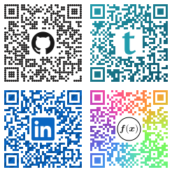

# dazzle

> **dazzle** */ˈdæz.əl/* *n.* — a group of zebras.

Typst QR codes with a logo in the middle, [sized](#safe-size) so they still scan.
Built on [zebra](https://typst.app/universe/package/zebra), which does the encoding (with the [qrcode](https://crates.io/crates/qrcode) crate) and the [native rendering](https://github.com/rojul/typst-zebra#native-rendering).
  - The center graphic is just Typst content: an `image`, some text, a symbol — anything you can typeset
  - Logo fill sized to the limit of the ISO QR standard's error correction
  - A drop-in superset of zebra: change the import and existing codes still render



```typ
#import "@preview/dazzle:0.1.0": qrcode

#qrcode("https://typst.app", graphic: text(36pt, sym.Omega))
```

## Arguments

- `data`: `str` | `bytes` (positional)

  As in zebra.

- `graphic`: `none` | `content` (default: `none`)

  What to put in the middle, such as an `image`.
  Images are scaled to fit the gap, keeping their aspect ratio.

- `graphic-size`: `auto` | `int` | `ratio` (default: `auto`)

  `auto` is the largest square that still decodes.
  An `int` is a side length in modules, and a `ratio` is a fraction of the code's width.
  Both are rounded down to an odd number of modules so the square is centred, and neither is checked: anything larger than `auto` may not scan.

- `options`: `dictionary` (default: `(:)`)

  zebra's [QR code options](https://github.com/rojul/typst-zebra#qr-code).
  With a graphic, `ec-level` defaults to `"h"` instead of zebra's `"m"`, since the higher the level, the bigger the graphic can be.
  Micro QR codes aren't supported with a graphic.

- `quiet-zone`, `width`, `height`, `module-size`, `fill`, `background-fill`, `clear`

  As in [zebra](https://github.com/rojul/typst-zebra#arguments).
  With a graphic, `clear` rectangles are cleared as well as the graphic's square.

Examples:
```typ
#let url = "https://typst.app"

// Smaller than the maximum
#qrcode(url, graphic: *sym.Omega*, graphic-size: 25%)

// A margin between the logo and the modules
#qrcode(url, graphic: pad(15%, image("logo.svg")))

// Any Typst fill, flowing round the gap
#qrcode(url, graphic: [], fill: gradient.conic(..color.map.rainbow))
```

## Safe Size

dazzle works out the worst case from the QR code standard, for every version and level, with 2 codewords per block left over for print defects and blur. It holds for any payload and is [checked with real decoders](https://github.com/munr0/dazzle/tree/master/tools).

## Fills

zebra draws the code as one Typst [curve](https://typst.app/docs/reference/visualize/curve/), and dazzle cuts the gap out of it, so `fill` and `background-fill` take anything Typst can paint:

- A colour
- A gradient, flowing across the whole code
- A tiling, for dots, stripes or any pattern

## Typesetting Alternatives

[fancyqr](https://ctan.org/pkg/fancyqr) is the go-to for logo QR codes in LaTeX.

| | dazzle (zebra) | fancyqr (qrcode) |
|-|-|-|
| Logo size | The largest that scans for any payload | Up to you, confirm it scans |
| Logo scales with the code | Yes | No |
| Colours | Any Typst paint: a colour, any gradient or a tiling | Simple gradients, alt-coloured finder patterns |
| Module styles | Squares, or any pattern you draw with a tiling | 13 built in |
| Drawing | One seamless vector path | Tile by tile, overlapped to hide seams |
